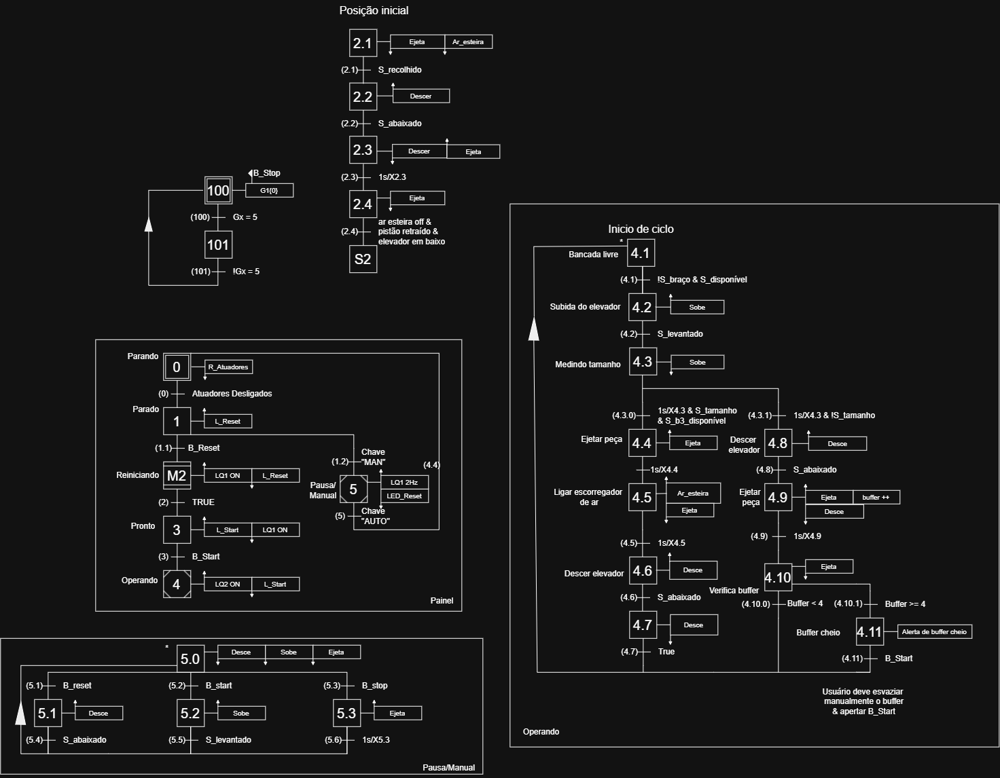
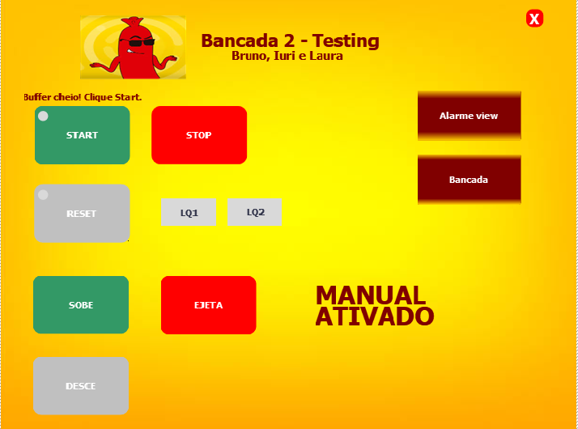
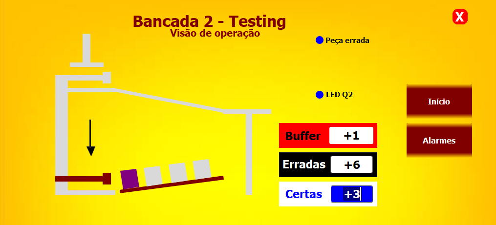
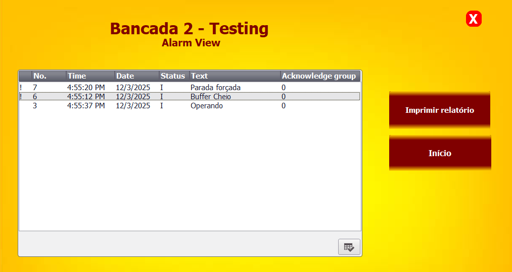
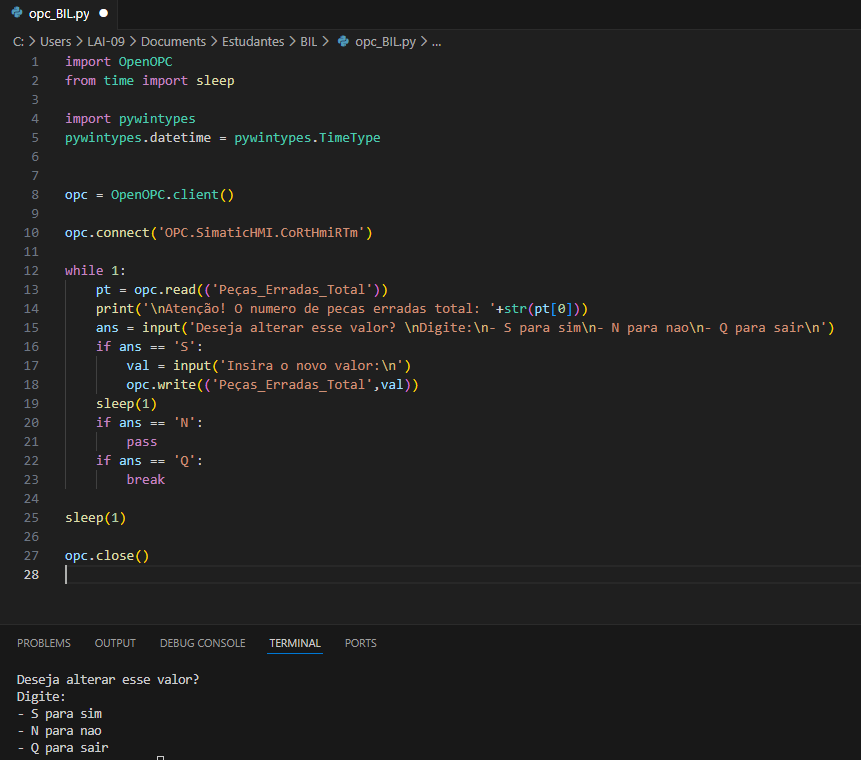

# Portfólio de Automação Industrial — CLP, SCADA, IHM & OPC

Repositório dedicado a projetos práticos de **Automação Industrial**, abrangendo modelagem de sistemas a eventos discretos (**GRAFCET**), programação de **CLPs Siemens**, desenvolvimento de sistemas supervisórios (**SCADA**), interfaces homem-máquina (**IHM**) e integração de dados industriais via **OPC**.

---

## 📦 Projeto: Bancada MPS — Estação *Testing* (Bancada 2)

Automação completa, supervisão e aquisição de dados de uma estação de teste e inspeção de peças baseada no sistema didático industrial **Festo MPS (*Modular Production System* — Estação *Testing*)**, desenvolvida no **Siemens TIA Portal V18**.

### 🎯 Objetivo do Sistema
Realizar a inspeção dimensional (altura/tamanho) de peças de forma automatizada, separando as peças aprovadas (encaminhadas para a próxima bancada através de uma rampa com colchão de ar) das peças rejeitadas (descartadas na rampa inferior de *buffer*), com monitoramento em tempo real via IHM/SCADA e comunicação externa via protocolo OPC.

---

## 🛠️ Tecnologias e Ferramentas Utilizadas

- **Ambiente de Engenharia:** Siemens TIA Portal V18
- **Controle e Lógica Sequencial:** GRAFCET (IEC 60848) / CLP Siemens SIMATIC
- **Sistema Supervisório (SCADA):** SIMATIC WinCC Runtime Advanced (PC Station) + WinCC Logging
- **Interface Homem-Máquina (IHM):** SIMATIC HMI KTP700 Basic PN
- **Comunicação Industrial:** Servidor OPC (`OPC.SimaticHMI.CoRtHmiRTm`) + Cliente em **Python** (`OpenOPC` / `pywintypes`)

---

## ⚙️ Arquitetura de Controle (GRAFCET)

A lógica de controle foi estruturada em diagramas GRAFCET coordenados para garantir operação segura e determinística:

1. **Segurança e Parada (`Etapas 100–101`):** Monitora o botão de parada (`B_Stop`), forçando o GRAFCET principal à etapa inicial segura (`G1{0}`) e desligando os atuadores (`R_Atuadores`).
2. **Gerenciamento de Painel e Modos (`Etapas 0–5`):**
   - Controla os estados **Parando**, **Parado**, **Reiniciando (`M2`)**, **Pronto**, **Operando** e **Pausa/Manual**.
   - **Macro-etapa de Posição Inicial (`M2`: `2.1–2.4`):** Garante o *homing* da bancada (recuo do pistão, descida do elevador até `S_abaixado` e limpeza da rampa).
3. **Ciclo Automático de Inspeção (`Etapas 4.1–4.11`):**
   - **Elevação e Medição (`4.1–4.3`):** Ao detectar peça disponível (`S_disponível`) e ausência de obstrução (`!S_braço`), o elevador sobe (`Sobe`) até `S_levantado` e realiza a verificação pelo sensor de tamanho (`S_tamanho`).
   - **Fluxo de Peça Certa (`4.4–4.7`):** Se a peça tiver a altura correta (`S_tamanho`) e a bancada seguinte estiver livre (`S_b3_disponível`), o pistão ejeta a peça (`Ejeta`) com o escorregador pneumático ligado (`Ar_esteira`) e o elevador retorna à base.
   - **Fluxo de Peça Errada e Controle de Buffer (`4.8–4.11`):** Se a peça for reprovada (`!S_tamanho`), o elevador desce primeiro e ejeta a peça na rampa inferior de descarte, incrementando o contador (`buffer++`). Caso o limite seja atingido (`Buffer >= 4`), o sistema entra em alerta de **Buffer Cheio (`4.11`)**, pausando o ciclo até o esvaziamento manual e confirmação no botão `B_Start`.
4. **Modo Pausa / Manual (`Etapas 5.0–5.3`):** Quando a chave seletora está na posição `MAN`, permite o acionamento individual dos atuadores (`Sobe`, `Desce` e `Ejeta`) para manutenção e testes.



---

## 🖥️ Telas do Sistema Supervisório (SCADA / IHM)

### 1. Tela Inicial de Comando e Operação
Permite o controle direto da bancada (`START`, `STOP`, `RESET`), visualização dos indicadores luminosos (`LQ1` e `LQ2`), operação manual dos atuadores (`SOBE`, `DESCE`, `EJETA`), indicação de modo (`MANUAL ATIVADO`) e avisos operacionais (`Buffer cheio!`).



### 2. Visão Sinóptica de Operação
Representação gráfica dinâmica do processo exibindo a posição do elevador, atuação do cilindro ejetor, ocupação da rampa de *buffer*, sinalizadores de status (`Peça errada`, `LED Q2`) e totalizadores em tempo real de peças no **Buffer**, **Erradas** e **Certas**.



### 3. Monitoramento de Alarmes e Eventos (*Alarm View*)
Tela dedicada ao registro cronológico de eventos e alarmes operacionais (como `Parada forçada`, `Buffer Cheio` e `Operando`), permitindo reconhecimento (*acknowledge*) de alarmes e exportação/impressão de relatórios.



---

## 🐍 Integração OPC com Python

O projeto conta com integração via **OPC DA** no script [`bancada_testing/opc_BIL.py`](./bancada_testing/opc_BIL.py), utilizando Python (`OpenOPC`) conectado ao servidor `OPC.SimaticHMI.CoRtHmiRTm` do WinCC Runtime. O código permite ler e sobrescrever variáveis do processo (como a tag `Peças_Erradas_Total`) em tempo real diretamente pelo terminal.



---

## 📂 Estrutura do Repositório

```text
portfolio-automacao/
├── README.md
└── bancada_testing/
    ├── Bancada_Testing_MPS.zip      # Projeto completo do Siemens TIA Portal V18 (CLP + SCADA + IHM)
    ├── opc_BIL.py                   # Script Python cliente OPC DA para leitura e escrita no WinCC Runtime
    ├── grafcet.png                  # Diagrama GRAFCET completo da lógica de controle
    ├── SCADA_start_screen.png       # Tela principal de comando do supervisório
    ├── visual_rep_wrong_piece.png   # Tela sinóptica de monitoramento de peças e contadores
    ├── alarm_view.png               # Tela de histórico e reconhecimento de alarmes
    └── opc_code.png                 # Captura do código Python de comunicação OPC
```

---

## 🚀 Como Executar o Projeto

1. Extraia o arquivo [`bancada_testing/Bancada_Testing_MPS.zip`](./bancada_testing/Bancada_Testing_MPS.zip).
2. Abra o arquivo `trabalho2pronto.ap18` no **Siemens TIA Portal V18** (com *STEP 7* e *WinCC Runtime Advanced / Basic* instalados).
3. Descarregue o programa no CLP (ou simule via **PLCSIM**) e inicie a simulação/runtime do **WinCC RT Advanced** (`PC station`) ou da IHM **KTP700 Basic PN**.
4. *(Opcional)* Com o WinCC Runtime ativo, execute o script [`bancada_testing/opc_BIL.py`](./bancada_testing/opc_BIL.py) (com `OpenOPC` e `pywin32` instalados) para interagir com as tags do servidor `OPC.SimaticHMI.CoRtHmiRTm`.
